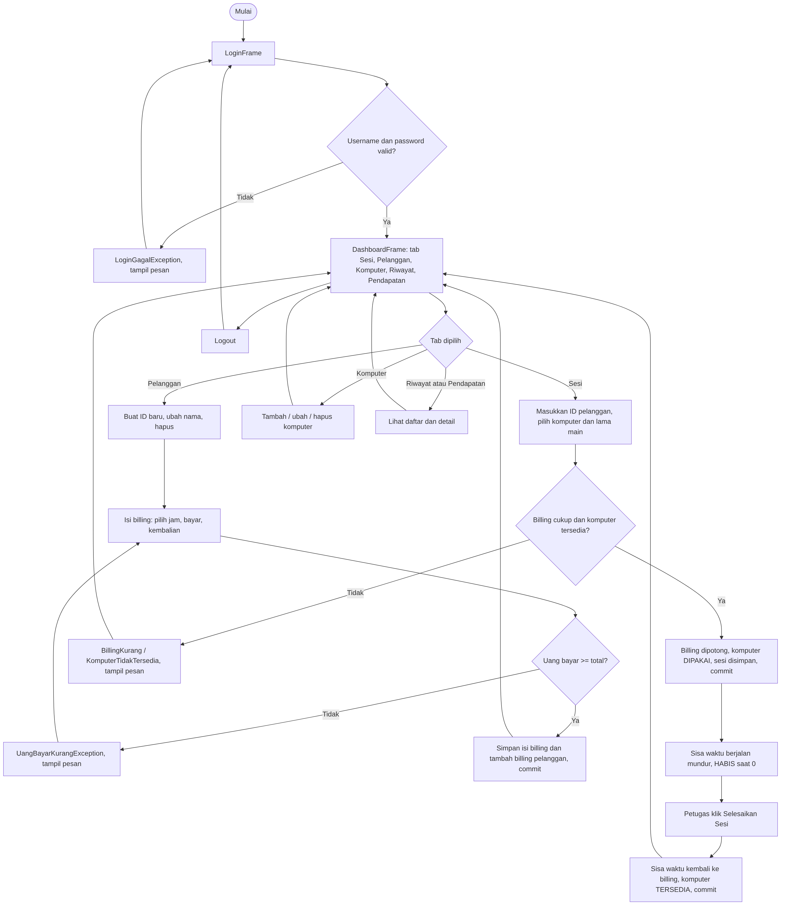
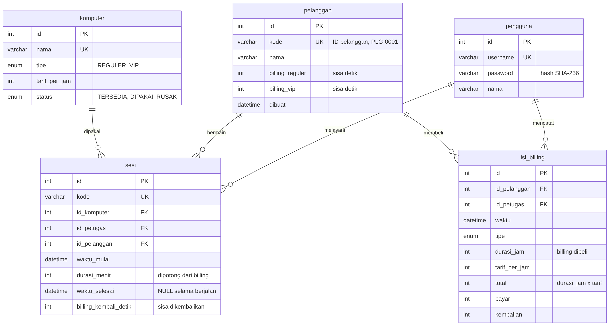
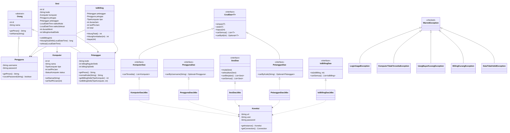
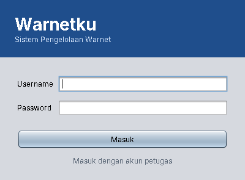
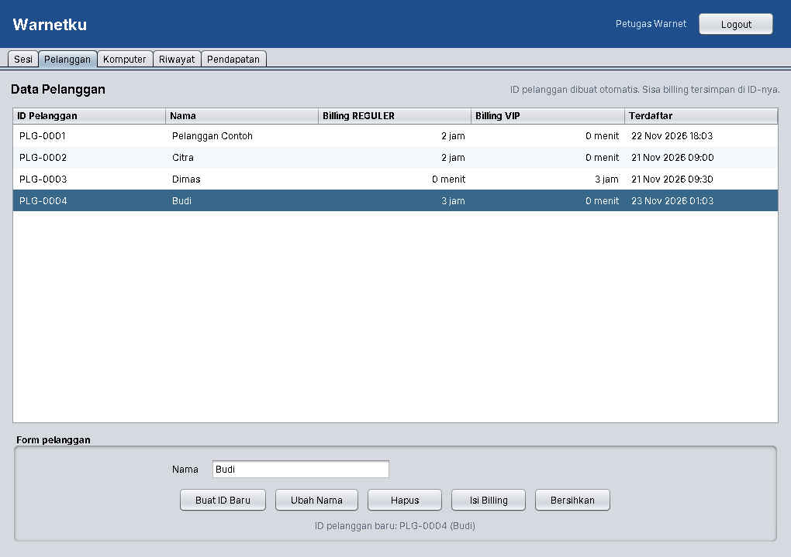
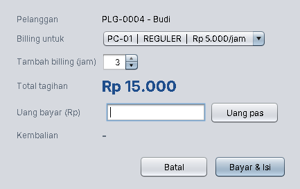
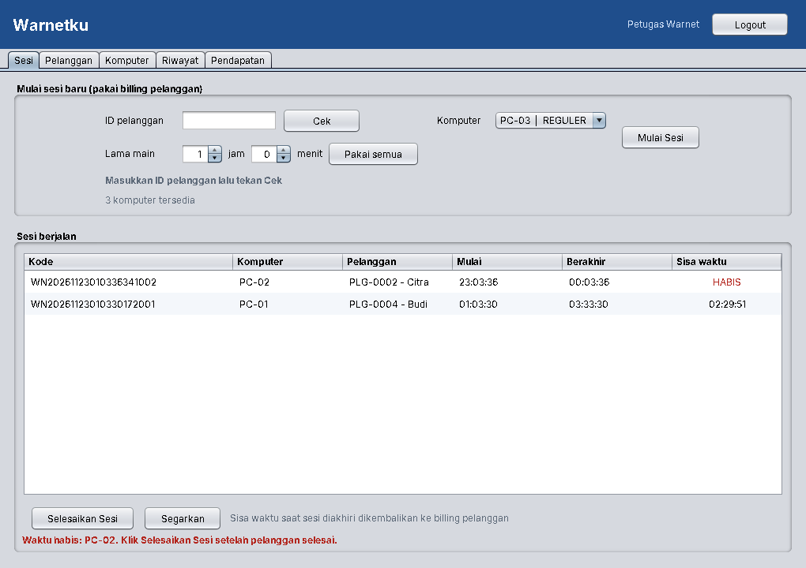
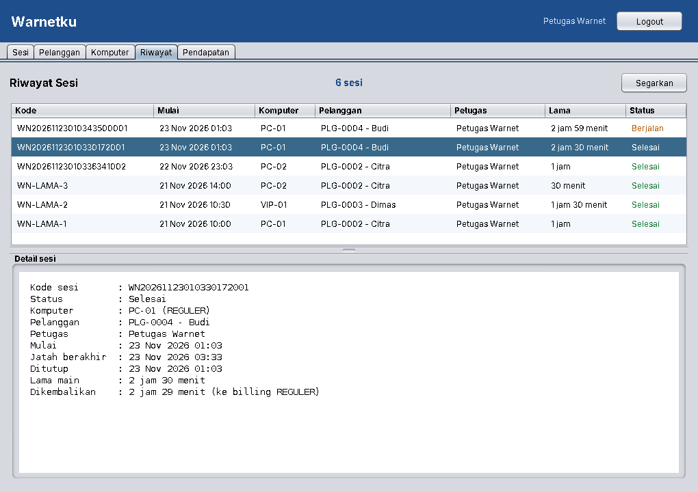
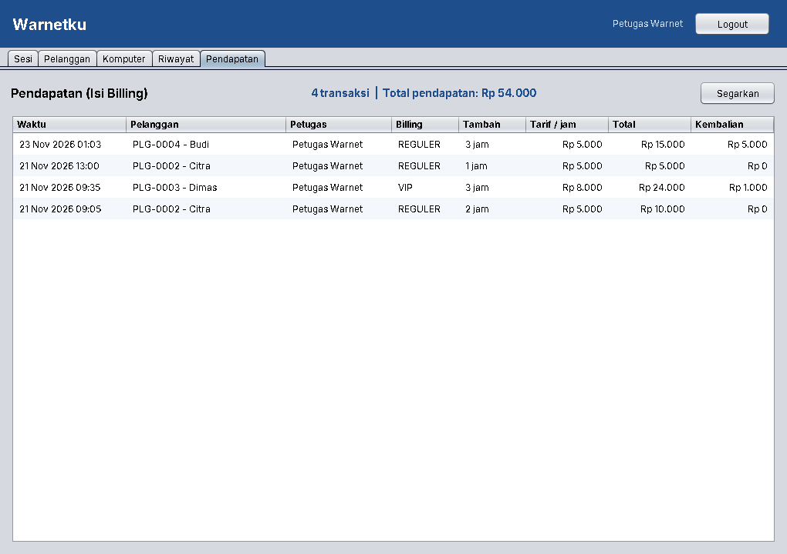
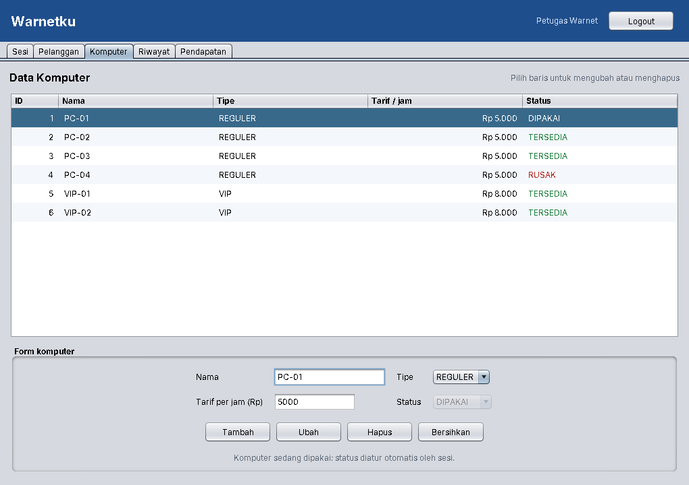

# Warnetku: Sistem Pengelolaan Warnet

Proyek Praktikum Pemrograman Berorientasi Objek 2026.

**Kelompok PBO Kelompok**

| Nama | NPM |
|---|---|
| Muhammad Hafidz Firdaus | 140810250018 |
| Steven Immanuel Butarbutar | 140810250027 |
| Rakhmat July Eldar Putra | 140810250066 |

**Teknologi:** Java 17+, Swing, dan MySQL (Laragon) lewat JDBC (driver `mysql-connector-j`). Tidak memakai framework atau pustaka lain.

Materi dibatasi pada slide praktikum minggu 1 sampai 9.

---

## 1. Ide dan Deskripsi

Warnet masih mencatat pemakaian komputer dan menghitung biaya secara manual (buku catatan dan stopwatch), sehingga rawan salah hitung durasi, salah tarif, dan status komputer sulit dipantau. **Warnetku** adalah aplikasi desktop sederhana yang membantu pencatatan data komputer, pelanggan dengan ID, billing (sisa waktu main) yang bisa disimpan dan diisi ulang, sesi pemakaian, dan riwayat pendapatan.

### Pengguna aplikasi

Hanya ada satu jenis akun, yaitu **petugas warnet**. Satu akun yang sama bisa membuat ID pelanggan, mengisi billing, melayani sesi, mengelola komputer dan tarif, serta melihat riwayat dan pendapatan. Pelanggan sendiri tidak login: mereka cukup menyebutkan ID kepada petugas. Tidak ada pemisahan akun admin dan operator.

---

## 2. Fungsionalitas

| Kode | Fitur | Deskripsi |
|---|---|---|
| F1 | Login | Masuk dengan username dan password. Gagal login menampilkan pesan dari exception. Setelah masuk, tampil lima tab: Sesi, Pelanggan, Komputer, Riwayat, dan Pendapatan. |
| F2 | Kelola komputer | Petugas menambah, mengubah, menghapus, dan melihat komputer (nama, tipe, tarif per jam, status) pada `JTable`. Input divalidasi (tarif tidak boleh negatif atau nol, nama wajib diisi). |
| F3 | Kelola pelanggan | Untuk pelanggan baru, petugas membuat ID otomatis (contoh `PLG-0001`) yang disimpan di database bersama nama. Petugas juga bisa mengubah nama dan menghapus pelanggan yang tidak punya sisa billing dan riwayat. Tabel menampilkan sisa billing tiap pelanggan. |
| F4 | Isi billing (bayar di awal) | Petugas memilih pelanggan, jumlah jam (1 sampai 24), dan jenis komputer yang menentukan tarif. Total dihitung otomatis, petugas mengisi uang bayar, kembalian dihitung otomatis. Billing bertambah dan transaksi tercatat dalam satu transaksi database. Uang bayar kurang ditolak lewat exception. Isi billing lagi kapan saja untuk memperpanjang. |
| F5 | Mulai sesi | Petugas cukup memasukkan ID pelanggan, memilih komputer yang tersedia, dan menentukan lama main (jam dan menit) atau menekan Pakai semua. Lama main dipotong dari billing pelanggan tanpa pembayaran baru. Billing yang kurang, komputer yang sudah dipakai atau rusak, dan pelanggan yang masih punya sesi berjalan ditolak lewat exception. |
| F6 | Pantau dan akhiri sesi | Tabel sesi berjalan menampilkan sisa waktu yang berjalan mundur setiap detik, ditandai HABIS berwarna merah saat habis. Petugas menekan Selesaikan Sesi. Jika masih ada sisa waktu, sisanya otomatis dikembalikan ke billing pelanggan dan bisa dipakai lagi nanti. Sesi tidak ditutup otomatis. |
| F7 | Riwayat sesi | Daftar semua sesi (kode, mulai, komputer, pelanggan, petugas, lama, status berjalan atau selesai). Memilih satu baris menampilkan detail, termasuk sisa waktu yang dikembalikan ke billing. |
| F8 | Pendapatan | Daftar semua pembelian billing beserta total pendapatan. Uang hanya masuk saat billing diisi, bukan saat sesi dimulai. |
| F9 | Logout | Kembali ke layar login. |

### Aturan billing

- Billing adalah sisa waktu main yang sudah dibayar dan tersimpan pada ID pelanggan (dalam detik). Billing REGULER dan billing VIP dicatat terpisah karena tarifnya berbeda.
- Pembayaran dilakukan di awal saat billing diisi. Biaya = jam yang dibeli x tarif per jam komputer acuan. Contoh: 3 jam reguler (Rp 5.000) = Rp 15.000.
- Tarif dibaca ulang dari database saat pembayaran diproses, lalu disalin ke catatan isi billing sehingga perubahan tarif nanti tidak mengubah riwayat.
- Saat sesi dimulai, billing jenis komputer yang dipakai dipotong sebesar lama main. Pelanggan yang masih punya sisa billing tidak perlu membayar lagi, kecuali ingin menambah billing.
- Saat sesi diakhiri sebelum waktunya, sisa waktu dikembalikan ke billing. Jika waktunya sudah habis, tidak ada yang dikembalikan.
- Batas: satu sesi maksimal 24 jam, satu pembelian maksimal 24 jam, dan billing tersimpan maksimal 100 jam per jenis. Satu pelanggan hanya boleh punya satu sesi berjalan.

---

## 3. Alur Aplikasi



### Alur isi billing (F4)

1. Petugas memilih pelanggan di tab Pelanggan lalu menekan Isi Billing. `IsiBillingDialog` menampilkan tagihan (jam x tarif) yang dihitung oleh `IsiBilling.hitungTotal()`.
2. Petugas mengisi uang bayar. Kembalian tampil langsung saat mengetik.
3. `IsiBillingDaoJdbc.isi(isi, uangBayar)` memanggil `isi.hitungKembalian(uangBayar)` lebih dulu. Jika uang kurang, `UangBayarKurangException` dilempar sebelum database disentuh.
4. DAO membuka koneksi dan `setAutoCommit(false)`, mengunci baris pelanggan dengan `SELECT ... FOR UPDATE`, lalu membaca ulang tarif komputer acuan dan menghitung ulang total.
5. Billing pelanggan ditambah (`UPDATE pelanggan SET billing_x = ?`) dan baris `isi_billing` di-insert.
6. Semua berhasil: `commit()`. Ada kegagalan: `rollback()`, sehingga billing dan catatan pembayaran selalu konsisten. Koneksi ditutup di blok `finally`.

### Alur mulai sesi (F5)

1. Petugas mengetik ID pelanggan lalu menekan Cek. `Pelanggan.normalKode()` merapikan ID (misalnya `4` menjadi `PLG-0004`), lalu `PelangganDao.cariByKode()` mencarinya.
2. `SesiPanel` membuat objek `Sesi(komputer, petugas, pelanggan, durasiMenit)` dan memanggil `SesiDaoJdbc.mulai(sesi)`.
3. DAO membuka transaksi, mengunci baris pelanggan, lalu memastikan pelanggan tidak punya sesi berjalan. `sesi.cekBilling()` melempar `BillingKurangException` jika billing tidak cukup.
4. `UPDATE komputer SET status = 'DIPAKAI' WHERE id = ? AND status = 'TERSEDIA'`. Jika tidak ada baris yang berubah, `KomputerTidakTersediaException` dilempar.
5. Billing dipotong sebesar lama main, lalu baris `sesi` di-insert. Semua berhasil: `commit()`, jika tidak `rollback()`.

### Alur mengakhiri sesi (F6)

1. Petugas memilih sesi berjalan lalu menekan Selesaikan Sesi. Dialog konfirmasi menyebut sisa waktu yang akan dikembalikan.
2. `sesi.selesai(waktu)` menghitung sisa detik. `SesiDaoJdbc.selesaikan(sesi)` menjalankan `UPDATE sesi SET waktu_selesai = ?, billing_kembali_detik = ? WHERE id = ? AND waktu_selesai IS NULL`. Jika tidak ada baris yang berubah, `DataTidakValidException` dilempar (sesi sudah diakhiri sebelumnya, sisa tidak dikembalikan dua kali).
3. Dalam transaksi yang sama: sisa waktu ditambahkan ke billing pelanggan, lalu `UPDATE komputer SET status = 'TERSEDIA' WHERE id = ? AND status = 'DIPAKAI'`, kemudian `commit()` atau `rollback()`.

---

## 4. Rancangan Database



Password disimpan sebagai hash SHA-256 (heksadesimal 64 karakter), bukan teks asli. Billing pelanggan disimpan dalam detik, terpisah untuk komputer REGULER dan VIP.

---

## 5. Rancangan Class

### 5.1 Struktur paket

```
com.partnerincrime.warnetku
├── Main.java
├── db         Koneksi (koneksi JDBC ke MySQL, singleton)
├── model      Orang (abstract), Pengguna, Pelanggan, Komputer, IsiBilling, Sesi,
│              TipeKomputer (enum), StatusKomputer (enum)
├── dao        CrudDao<T>, KomputerDao, PenggunaDao, PelangganDao,
│              IsiBillingDao, SesiDao, KomputerDaoJdbc, PenggunaDaoJdbc,
│              PelangganDaoJdbc, IsiBillingDaoJdbc, SesiDaoJdbc, DaoUtil
├── exception  WarnetException, LoginGagalException,
│              KomputerTidakTersediaException, UangBayarKurangException,
│              BillingKurangException, DataTidakValidException
└── view       LoginFrame, DashboardFrame, KomputerPanel, PelangganPanel,
               SesiPanel, IsiBillingDialog, RiwayatPanel, PendapatanPanel,
               Tampilan, DapatDimuatUlang
```

### 5.2 Diagram class



### 5.3 Peran tiap bagian

| Bagian | Tanggung jawab |
|---|---|
| `model` | Menyimpan data dan aturan sederhana (validasi di setter, hitung total, kembalian, cek billing, dan sisa waktu). Atribut `private`. `Orang` adalah class abstract induk `Pengguna` (petugas) dan `Pelanggan`: id dan validasi nama ada di satu tempat, sedangkan `getPeran()` di-override tiap turunan. |
| `dao` | Satu-satunya tempat yang memakai SQL. Hasil pencarian tunggal dikembalikan sebagai `Optional`. |
| `exception` | Kesalahan aplikasi bertipe checked, pesannya langsung ditampilkan lewat `JOptionPane`. |
| `db.Koneksi` | Satu titik untuk membuka koneksi JDBC ke MySQL. URL, user, dan password bisa diatur lewat konstanta atau environment variable. |
| `view` | Hanya urusan tampilan dan event. Logika data dipanggil lewat DAO dan model. `Tampilan` berisi format teks dan gaya tabel, `DapatDimuatUlang` dipakai tab untuk memuat ulang data saat dibuka. |

---

## 6. Tahapan Pengerjaan

| Tahap | Isi | Fitur |
|---|---|---|
| 1 | Scaffolding Maven, `schema.sql`, `Koneksi`, `Main` | Setup proyek |
| 2 | Model, exception, DAO pengguna, `LoginFrame` | F1 |
| 3 | `Komputer`, `KomputerDao`, `KomputerPanel` | F2 |
| 4 | `Pelanggan`, `PelangganDao`, `PelangganPanel` (ID otomatis) | F3 |
| 5 | `IsiBilling`, `IsiBillingDao`, `IsiBillingDialog`, `PendapatanPanel` | F4, F8 |
| 6 | `Sesi`, `SesiPanel`, `SesiDao` (mulai, selesaikan, sisa waktu kembali ke billing) | F5, F6 |
| 7 | `RiwayatPanel`, `DashboardFrame` dengan lima tab, logout | F7, F9 |
| 8 | README, tangkapan layar, pengecekan akhir | Dokumentasi |

---

## 7. Tampilan Aplikasi

| Masuk | Pelanggan (ID otomatis dan sisa billing) |
|---|---|
|  |  |

| Isi billing (bayar di awal) | Sesi berjalan (sisa waktu mundur) |
|---|---|
|  |  |

| Riwayat sesi | Pendapatan |
|---|---|
|  |  |



---

## 8. Cara Menjalankan

Kebutuhan: JDK 17 atau lebih baru, Maven, dan MySQL (Laragon).

1. Jalankan MySQL lewat Laragon.
2. Impor skema dan data awal. Dari terminal Laragon:

   ```bash
   mysql -u root < database/schema.sql
   ```

   Atau buka `database/schema.sql` di HeidiSQL / phpMyAdmin lalu jalankan. Aman diulang, data tidak tertimpa.

   **Jika sebelumnya sudah mengimpor versi lama** (sebelum ada tabel `pelanggan`), hapus dulu database lamanya, lalu impor ulang. Di HeidiSQL: klik kanan database `warnetku`, pilih *Drop*. Atau jalankan `DROP DATABASE warnetku;`. Data uji di dalamnya ikut terhapus.
3. Jika user atau password MySQL bukan bawaan Laragon (`root`, tanpa password), sesuaikan konstanta di `db/Koneksi.java`, atau set environment variable `WARNETKU_DB_URL`, `WARNETKU_DB_USER`, `WARNETKU_DB_PASSWORD`.
4. Build dan jalankan:

   ```bash
   mvn clean package
   java -jar target/warnetku.jar
   ```

   Atau buka proyek di IDE (NetBeans / IntelliJ / Eclipse) dan jalankan `Main`.

### Akun awal

| Username | Password |
|---|---|
| `admin` | `admin123` |

Satu akun ini bisa memakai semua fitur.

### Data awal pelanggan

Satu pelanggan contoh `PLG-0001` (Pelanggan Contoh) dengan billing REGULER 2 jam, supaya sesi bisa langsung dicoba. Pelanggan baru dibuat lewat tab Pelanggan.

### Contoh alur mencoba

1. Tab **Pelanggan**: isi nama, klik *Buat ID Baru*, catat ID-nya.
2. Pilih pelanggan itu, klik *Isi Billing*, pilih jam, isi uang bayar.
3. Tab **Sesi**: ketik ID pelanggan, klik *Cek*, pilih komputer dan lama main, klik *Mulai Sesi*.
4. Klik *Selesaikan Sesi* sebelum waktu habis, lalu lihat sisa waktu kembali ke billing di tab Pelanggan. Tab **Pendapatan** menunjukkan uang yang masuk.

### Data awal komputer

`PC-01` sampai `PC-03` (REGULER, Rp 5.000/jam), `PC-04` (REGULER, status RUSAK), `VIP-01` dan `VIP-02` (VIP, Rp 8.000/jam).

### Jika aplikasi tidak bisa terhubung

Muncul dialog "Koneksi gagal" saat dibuka. Cek bahwa MySQL sudah berjalan, `schema.sql` sudah diimpor, dan setelan di langkah 3 benar.

### Mengubah diagram

Kode sumber diagram (Mermaid) ada di `images/sumber/`. Ubah lalu render ulang menjadi PNG, misalnya dengan `mmdc -i images/sumber/diagram-class.mmd -o images/diagram-class.png`.
